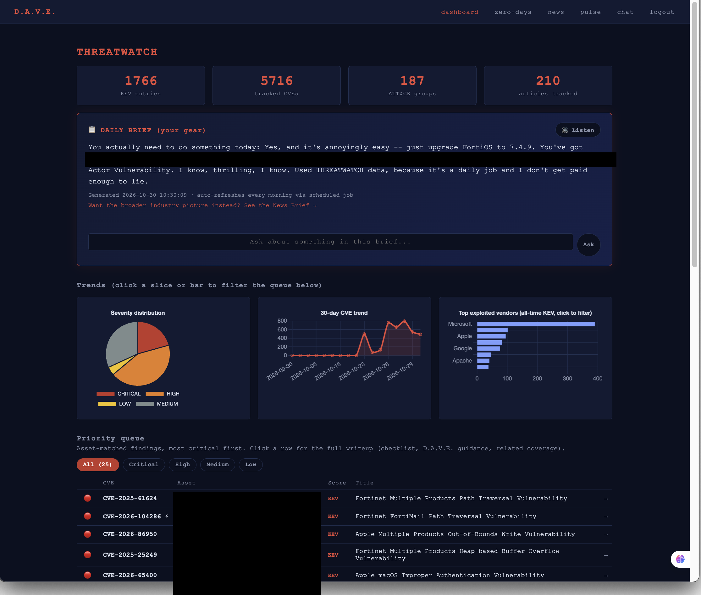
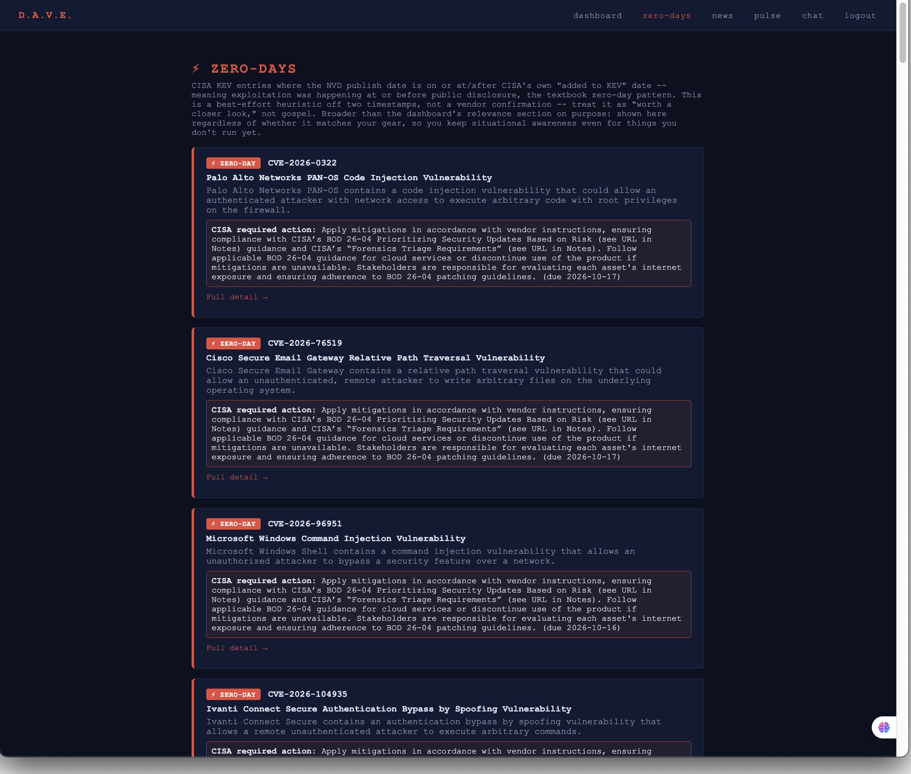
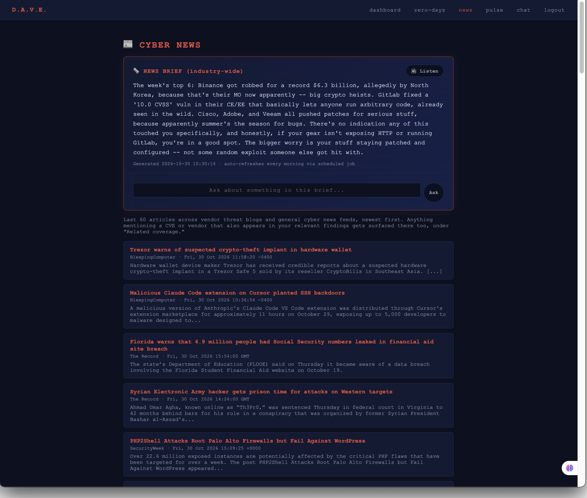
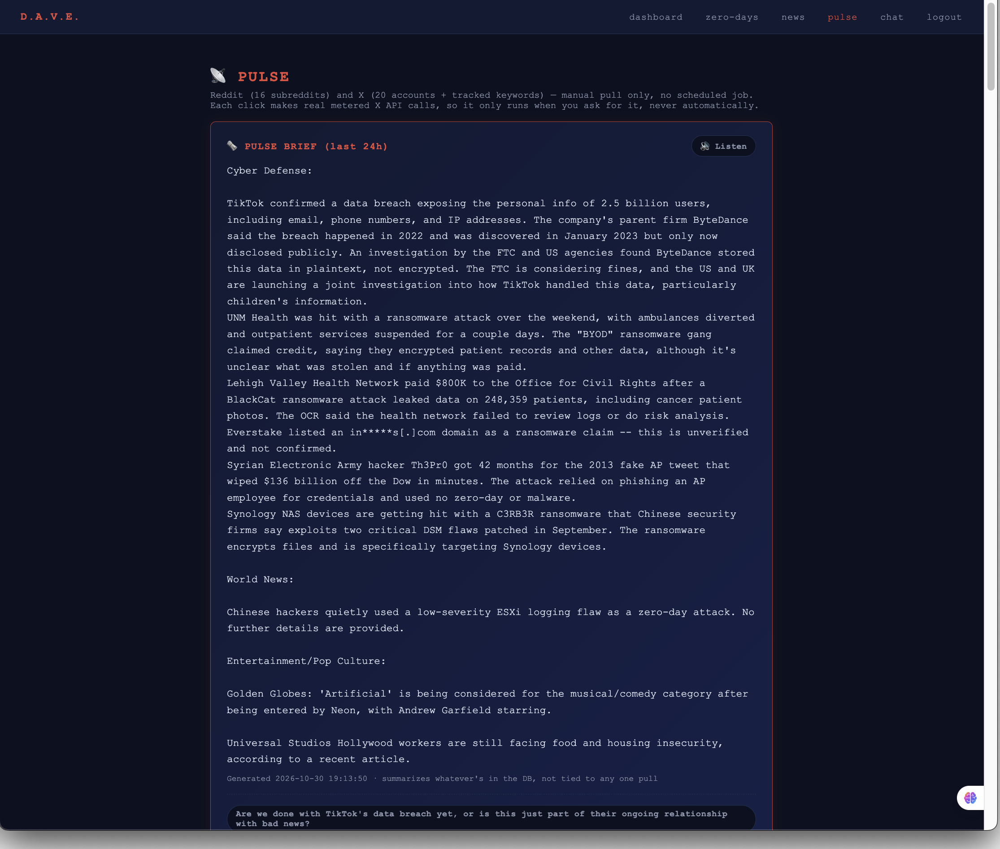
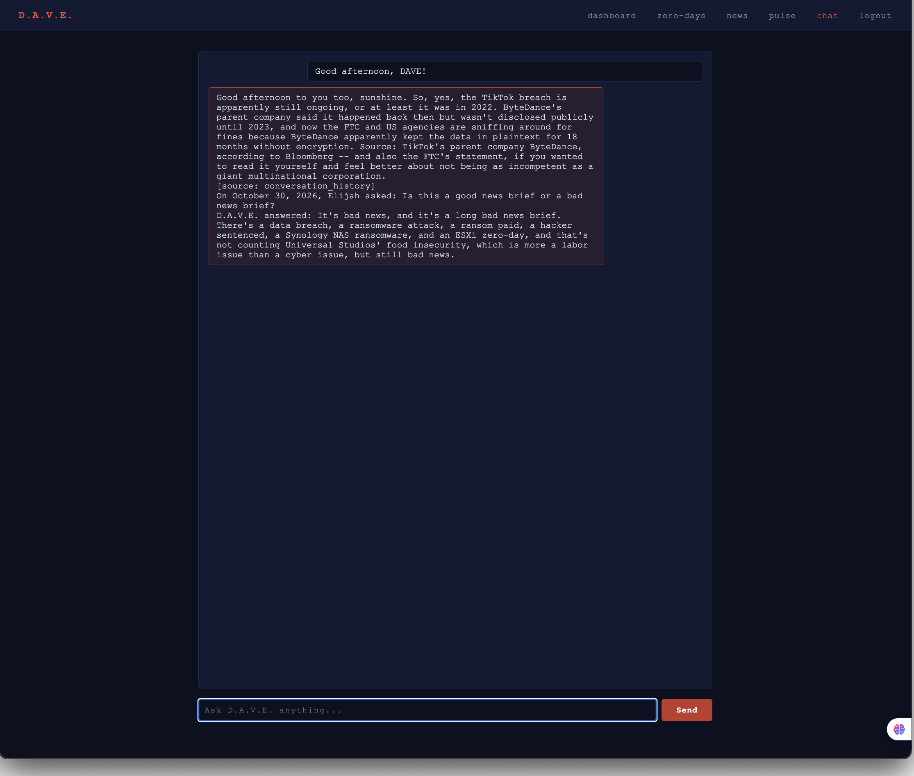

# D.A.V.E. — Distributed Autonomous Virtual Entity

A self-hosted homelab AI assistant, built from scratch: a locally-run LLM
pipeline, a password+MFA-walled web dashboard, and three independent data
modules it reads from (vulnerability intel, cyber/defense news, and a
personal Reddit/X feed). Everything runs on a single home server, exposed to
the internet only through Tailscale Funnel — no cloud hosting, no port
forwarding, no third-party API holding the actual assistant.

This repo covers **daveweb** (the dashboard/chat frontend) and
**threatwatch** (the vulnerability-intel collector it displays). The
Reddit/X collector, **pulse**, is a separate repo: [github.com/elijahbeese/pulse](https://github.com/elijahbeese/pulse).
The actual LLM core — `jarvis_v2/api_server.py`, which owns the
Ollama/Chroma connections and does the real retrieval + generation — stays
private; this repo is everything that sits on top of it.

## Why it's built this way

Three decisions shape everything else here:

- **Local-first.** The model, the vector store, and every database are on
  hardware I own. Nothing about "what did I ask my assistant" or "what's on
  my network" leaves the house except the final rendered page, over a
  connection I control.
- **Read-only until proven otherwise.** Every module here *collects and
  summarizes* data. None of them autonomously acts — patches a system,
  posts somewhere, spends money — without an explicit click from me. Even
  pulse's real-money X API calls only fire on a manual "Pull now," never as
  a side effect of asking a question.
- **Boring auth over clever auth.** daveweb is a single-user app with a
  password + TOTP wall, stored as a hash and a secret in an env file — no
  session database, no OAuth, no accounts table. Multi-user auth for a
  one-person dashboard is just attack surface with no benefit.

## Architecture

```
                         (your phone/laptop, anywhere)
                                    |
                           HTTPS (Tailscale Funnel)
                                    |
                                    v
                    +------------------------------+
                    |   daveweb  (Flask, gunicorn)  |
                    |   password + TOTP MFA wall    |
                    +------------------------------+
                      |         |          |
            dashboard |   news/ |          | chat
            /zero-days|   pulse |          |
                 pages |   pages|          v
                      v         v    +--------------------+
              +---------------------+| jarvis_v2            |
              | threatwatch (SQLite)|| api_server.py        |
              | - CISA KEV          || - Ollama (local LLM) |
              | - NVD CVEs          || - Chroma (vectors)   |
              | - MITRE ATT&CK      || - session/auth       |
              | - vendor RSS/OTX    |+----------------------+
              +---------------------+
                      ^
                      | (separate repo, own SQLite db)
              +---------------------+
              | pulse                |
              | - Reddit (PRAW)      |
              | - X API v2           |
              +---------------------+
```

daveweb never talks to Ollama/Chroma directly — it proxies chat requests
into `api_server.py`'s own `/ask` endpoint over localhost HTTP
(`dave_api.py`), the same way a second client would. That keeps exactly one
process owning the expensive model/vector-store connections, and means
daveweb itself is a genuinely thin layer: auth wall, page rendering, and a
few SQLite reads.

## The pages

**Dashboard** (`/`) — live counts from threatwatch (KEV entries, tracked
CVEs, ATT&CK groups, articles), a severity-distribution pie chart, a 30-day
CVE trend line, top exploited vendors, and the asset-matched **priority
queue**: every tracked finding that matches something in my actual gear
list (`threatwatch/assets.py`), ranked by criticality, clickable through to
a full writeup (CISA's required action, a static remediation checklist, and
on-demand D.A.V.E.-written mitigation guidance for that specific CVE
against my specific setup).

**Zero-days** (`/zero-days`) — a broader view than the dashboard's queue: every
CISA KEV entry whose NVD publish date is on or after its "added to KEV"
date — the signature of a vulnerability that was being exploited before it
was publicly known. Shown regardless of whether it matches my gear, for
situational awareness.

**News** (`/news`) — the last 60 pulled articles across vendor threat blogs
and general cyber news RSS feeds, plus an **industry-wide brief**: a daily
LLM-generated summary covering the top stories, each with a short note on
whether/how it actually relates to my specific setup (not just a reprint of
the dashboard's asset-matched brief).

**Pulse** (`/pulse`) — manual-pull-only Reddit + X feed across a hand-picked
list of subreddits/accounts/keywords (cyber, military/defense, local news,
a little entertainment), plus a **pulse brief**: a from-scratch summarizer
that reads everything pulled in the last 24h and writes a full, paraphrased
writeup — not a top-N digest, but weighted like a real newspaper, so an
entertainment subreddit having the highest post volume on a given day
doesn't let it dominate the brief.

**Chat** (`/chat`) — a direct line into `api_server.py`'s own `/ask`, with
the same retrieval, web search, and interaction logging the assistant
already does everywhere else. No reimplementation here.

### Brief-chat: asking follow-ups about a brief

Every brief panel (threat/news/pulse) has a small chat box under it:

- When a brief is generated, D.A.V.E. also writes 4 short follow-up
  questions grounded *only* in things literally named in that brief (a
  specific CVE, company, or event — never a plausible-sounding but
  made-up one), shown as clickable chips.
- Typing a free-text question, or clicking a chip, re-sends the full brief
  text as context plus up to the last 6 exchanges in that session, so a
  follow-up to a follow-up still holds together.
- Unlike the brief itself (which is deliberately flat, neutral,
  wire-service prose so it reads well as generated audio), these answers
  use D.A.V.E.'s normal web-search-enabled chat path — so a follow-up can
  pull in detail the original brief's bounded data didn't have room for.

## Data flow, end to end

1. **Collection** (scheduled, independent of daveweb): threatwatch's
   `run_collectors.py` runs every few hours via a systemd timer, pulling
   CISA KEV, NVD, MITRE ATT&CK, vendor RSS, and OTX into one SQLite file.
   pulse only runs on a manual click (see its own repo for why).
2. **Relevance matching**: `threatwatch/relevance.py` keyword-matches new
   findings against a hand-maintained asset list, scores them, and is what
   the dashboard's priority queue actually reads.
3. **Daily briefs**: a systemd timer runs `generate_daily_brief.py` every
   morning, asking D.A.V.E. (through the same `/ask` path chat uses, just
   with web search off) to summarize the day's threat/news data, caching
   the result by date so no page load ever blocks on an LLM call. Pulse's
   brief is always on-demand only, generated by a button click on the
   `/pulse` page itself.
4. **Serving**: daveweb reads straight from threatwatch's and pulse's
   SQLite files on page load — no API layer between them, since they're
   all on the same box.

## Security notes

- Nothing binds to a public interface directly — daveweb listens on
  `127.0.0.1` only; Tailscale Funnel is the only thing that makes it
  internet-reachable, with TLS handled entirely by Tailscale.
- Login is password + TOTP, generated once by `setup_mfa.py` (never stores
  the plaintext password or a plain TOTP seed — a werkzeug hash and a
  base32 secret, both only ever read from environment variables).
- Every secret — the password hash, the TOTP secret, the Flask session
  key, API keys — lives in a gitignored `.env`, never in code. The
  `.env.example` files in both `daveweb/` and `threatwatch/` show exactly
  what's expected, with blank values.
- Session cookies are httponly, SameSite=Lax, and expire after 12 hours by
  default.

## Setup

Each component has its own detailed setup README:

- [`daveweb/README.md`](./daveweb/README.md) — the dashboard/chat app, MFA
  setup, systemd services, Tailscale Funnel exposure.
- [`threatwatch/README.md`](./threatwatch/README.md) — the vulnerability
  collector, its data sources, schema, and deploy timer.
- pulse has its own separate repo and README:
  [github.com/elijahbeese/pulse](https://github.com/elijahbeese/pulse).

## Screenshots

Specific asset names and CVE-to-device pairings are blacked out below; everything
else is live, real data from my own homelab.

**Dashboard** — live counts, severity breakdown, 30-day CVE trend, and the
asset-matched priority queue (asset column redacted):



**Zero-days** — every CISA KEV entry that looks like it was exploited before
public disclosure, regardless of whether it matches my gear:



**News** — the industry-wide brief plus the last 60 pulled articles, with the
brief-chat box underneath for follow-up questions:



**Pulse** — the manual-pull Reddit/X brief, weighted like a newspaper so
entertainment/pop-culture doesn't drown out cyber/defense/world news:



**Chat** — a direct line into D.A.V.E.'s own `/ask`, same retrieval and
web-search the rest of the app uses:


